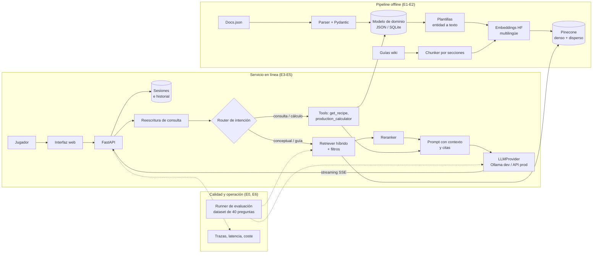

# Satisfactory RAG Assistant — Master Plan

Nov 5, 2026 · @Diego

## Supuestos de partida

El plan arranca hoy con tres supuestos; si alguno no es correcto, se ajusta antes de desglosar la Épica 1.

- **Fuera de alcance:** mods, speedrun, lore, mapas de recursos por coordenadas y planificación de layouts físicos de fábricas. El bot explica y calcula; no diseña la fábrica.
- **Idioma:** los datos de Docs.json vienen en inglés; el bot responde en español y mantiene los nombres de ítems en inglés entre paréntesis ("Placa de hierro reforzada (Reinforced Iron Plate)"), porque así los buscan los jugadores en la wiki y en el juego.
- **Producción = demo pública de bajo tráfico:** decenas de usuarios al día, no miles. Eso permite quedarse dentro de los planes gratuitos y de los 10 USD/mes.

## 1. Análisis crítico

**Veredicto: arquitectura híbrida.** RAG puro resuelve bien 2 de los 4 tipos de pregunta; los otros 2 necesitan datos estructurados y código determinista. La capa de RAG sigue siendo el centro del aprendizaje, pero el router y las herramientas son lo que hace que el bot no mienta con números.

### Qué resuelve cada enfoque

| Tipo de pregunta | Ejemplo | RAG puro | Mejor enfoque |
| --- | --- | --- | --- |
| Conceptual | ¿Para qué sirve el Constructor? | Bien | RAG |
| Consulta exacta | ¿Qué necesito para Rotores? | Regular: puede mezclar receta estándar y alternativas, o recuperar el chunk equivocado | Tool `get_recipe(item)` sobre datos estructurados + RAG para explicar |
| Cuantitativa | ¿Cuántos Constructores para 60 placas/min? | Mal: el LLM calcula mal ratios y overclock | Tool `production_calculator(item, rate)` en Python puro |
| Guía | ¿Qué automatizo primero? | Bien si hay guías de la wiki indexadas | RAG + filtro por tier |

### Por qué no basta con RAG para los números

Una receta en Docs.json dice, por ejemplo, "1 Lingote de hierro → 1 Varilla en 4 s". Calcular cuántas máquinas hacen falta para 60/min exige convertir tiempos a tasas por minuto, dividir y redondear hacia arriba, y para cadenas completas, recorrer un grafo de dependencias. Un modelo local de 7–8B parámetros falla esto con frecuencia y con total confianza. La regla del proyecto: **el LLM nunca hace aritmética; la hace Python y el LLM la explica.**

### Cómo convertir Docs.json en documentos para embeddings

1. **No indexes JSON crudo.** Claves como `mIngredients` con rutas tipo `Desc_IronIngot_C` producen embeddings pobres. Parsea a modelos tipados (Pydantic) y guarda ese modelo como fuente de verdad en un JSON/SQLite propio.
2. **Un documento por entidad, generado como texto natural** con plantillas: "Rotor (Rotor) es un componente de tier 2. Se fabrica en el Ensamblador a partir de 5 Varillas de hierro y 25 Tornillos, produciendo 4 por minuto. Se usa en: Motor, Planta de energía…". Las entidades de Satisfactory son cortas, así que normalmente no hace falta dividir: 1 entidad = 1 chunk.
3. **Tipos de documento separados:** ítem, receta (estándar y alternativa por separado), edificio, hito/tier, guía de la wiki. Para la wiki sí aplica chunking por secciones (por encabezados, 300–500 tokens).
4. **Metadatos ricos para filtrar:** `doc_type`, `item_id`, `tier`, `is_alternate`, `building`, `game_version`, `source`. Con eso, "recetas alternativas de tornillos" se resuelve con un filtro, no con suerte semántica.
5. **Nombres en inglés y español dentro del texto,** para que las búsquedas por cualquiera de los dos coincidan, y para alimentar la búsqueda por palabra clave (hybrid search) con los nombres exactos.
6. **El texto del documento debe ser determinista y versionado:** si cambias la plantilla, re-indexas todo y comparas métricas. Así medirás si una plantilla es mejor que otra, que es uno de los aprendizajes más valiosos del proyecto.

### Revisión del stack

| Pieza | Propuesta | Veredicto | Trade-off |
| --- | --- | --- | --- |
| Base vectorial | Pinecone | Se mantiene | El plan gratuito (Starter) incluye 2 GB, 2M write units y 1M read units al mes, hasta 5 índices, solo en AWS us-east-1. Sobra para unos pocos miles de documentos. Ojo: los índices de Starter se pausan tras 3 semanas sin actividad; en semanas sin avance, programa un ping. |
| Embeddings | HuggingFace | Se mantiene, con modelo multilingüe | Usa un modelo que soporte español e inglés (familia `multilingual-e5` o `bge-m3`). Corre en CPU para el volumen de este proyecto: coste 0. Fija el modelo y su dimensión en la configuración; cambiarlo implica re-indexar. |
| LLM en desarrollo | Ollama | Se mantiene | Perfecto para iterar sin coste. Elige un modelo con buen function calling (familia Qwen o Llama 3.x de 7–8B). |
| LLM en producción | Ollama | **Cambio recomendado** | Hospedar Ollama 24/7 necesita una máquina con varios GB de RAM y, para respuestas fluidas, GPU: eso no cabe en 10 USD/mes. Recomiendo una interfaz `LLMProvider` con dos implementaciones: Ollama (local) y una API compatible con OpenAI con plan gratuito (Groq, por ejemplo, ofrece en su plan gratuito 30 peticiones/min y 1.000/día en modelos como gpt-oss-120b, suficiente para una demo). Cambiar de proveedor = cambiar una variable de entorno. |
| Backend | FastAPI | Se mantiene | Despliegue en un contenedor en un plan gratuito o de pocos dólares (Render, Fly.io, Railway o Hugging Face Spaces). Confirmaremos opción y límites al llegar a la Épica 6. |
| Reranking | No previsto | Añadir en E3 | Un cross-encoder pequeño de HuggingFace en CPU, o el reranker alojado de Pinecone si cabe en el plan gratuito. |
| Evaluación | No previsto | Añadir desde E0 | Script propio en pytest para retrieval (recall@k, MRR) y Ragas o LLM-as-judge para la RAG Triad en E4/E6. |

Presupuesto estimado en producción: **0–5 USD/mes** (Pinecone Starter + LLM con plan gratuito + hosting gratuito), dejando margen para un dominio o para subir de plan el hosting.

## 2. Arquitectura

Dos caminos comparten la misma fuente de verdad: el pipeline offline construye el modelo de dominio y el índice; en línea, un router decide si la pregunta va a RAG, a herramientas deterministas o a ambos.



La pieza clave es `DM`: tanto las plantillas que alimentan Pinecone como las herramientas de cálculo leen del mismo modelo de dominio, así que el texto indexado y los números calculados nunca se contradicen.

## 3. Definiciones del proyecto

### Definition of Ready (una historia puede pasar a "En progreso" si…)

- [ ] Tiene redacción "Como… quiero… para…" y 2–4 criterios Given/When/Then verificables.
- [ ] Sus dependencias están en "Hecho".
- [ ] Está dividida en tareas de 4 h o menos, con estimación.
- [ ] Cabe en 1–2 sesiones de trabajo (máximo 5 story points; si es 8, se divide).
- [ ] Si toca retrieval o generación: sé con qué métrica del dataset de evaluación voy a comprobarla.

### Definition of Done (una historia pasa a "Hecho" si…)

- [ ] Todos los criterios de aceptación se cumplen y se pueden demostrar con un comando o una petición.
- [ ] Código en `main` vía Pull Request propio (aunque te lo apruebes tú: practica el flujo).
- [ ] `ruff` y `mypy` sin errores; tests nuevos en verde con `pytest`.
- [ ] Si cambió datos, plantillas, embeddings, prompts o retrieval: evaluación ejecutada y resultado anotado en `docs/eval-log.md` (fecha, cambio, métricas antes/después).
- [ ] Decisiones de arquitectura relevantes registradas como ADR en `docs/adr/`.
- [ ] Horas reales anotadas en la tarjeta de Trello.

### Estructura del repositorio

```text
satisfactory-rag/
├── data/
│   ├── raw/              # Docs.json original (git-ignored, con checksum en manifest)
│   ├── processed/        # entidades normalizadas (items, recipes, buildings)
│   └── documents/        # documentos de texto listos para embeddings (JSONL)
├── eval/
│   ├── dataset.jsonl     # preguntas de evaluación con respuestas esperadas
│   ├── schema.py         # modelo Pydantic de una pregunta de evaluación
│   └── run_eval.py       # runner de métricas
├── src/satisrag/
│   ├── ingestion/        # parser de Docs.json, normalización, modelos Pydantic
│   ├── documents/        # plantillas entidad → texto
│   ├── indexing/         # embeddings + upsert a Pinecone
│   ├── retrieval/        # búsqueda, filtros, hybrid, rerank
│   ├── tools/            # get_recipe, production_calculator
│   ├── llm/              # LLMProvider (Ollama / API), prompts
│   ├── agent/            # router + orquestación RAG/tools
│   └── api/              # FastAPI: rutas, sesiones, streaming
├── tests/
├── docs/
│   ├── adr/              # Architecture Decision Records
│   ├── scope.md
│   └── eval-log.md
├── scripts/              # CLI: ingest, index, eval
├── .github/workflows/    # CI: lint + tests + eval rápida
├── pyproject.toml        # uv o Poetry
├── Dockerfile
└── .env.example
```

### Ramas y commits

- **Flujo:** trunk-based. `main` siempre funciona; una rama por historia: `feat/US0-2-1-eval-schema`, `fix/…`, `chore/…`, `docs/…`.
- **Commits:** Conventional Commits con el ID de la historia: `feat(eval): add question schema [US0.2.1]`. Tipos: `feat`, `fix`, `refactor`, `test`, `docs`, `chore`, `perf`, `eval` (para cambios que solo afectan a métricas o al dataset).
- **Versionado:** una etiqueta `vX.Y.0` al cerrar cada sprint, con las métricas de evaluación en la descripción del release.

## 4. Backlog de alto nivel

**Total estimado: 202 horas, 7 épicas y 30 features.** A 20 h/semana son unas 10 semanas efectivas; contando semanas sin avance, espera 3–4 meses. Las estimaciones de E3 en adelante son las menos fiables y se recalibrarán con tus horas reales.

| Épica | Objetivo y criterio de éxito | Features | Horas |
| --- | --- | --- | --- |
| **E0 · Alcance y evaluación** | Saber qué es "funcionar bien" antes de escribir el RAG. Éxito: `scope.md` + 40 preguntas evaluables + runner que se ejecuta. | F0.1 Alcance y usuario objetivo (3 h) · F0.2 Dataset de evaluación (7 h) · F0.3 Repositorio y herramientas base (4 h) | 14 |
| **E1 · Datos** | Una fuente de verdad estructurada y fiable. Éxito: 100% de recetas del dataset de evaluación coinciden con el juego. | F1.1 Extracción y parseo de Docs.json (6 h) · F1.2 Modelo de dominio normalizado y grafo de recetas (8 h) · F1.3 Generación de documentos con plantillas (6 h) · F1.4 Ingesta de guías de la wiki (5 h, Could) · F1.5 Validación de calidad y manifest de versión (3 h) | 28 |
| **E2 · Indexación** | Índice reproducible e idempotente en Pinecone. Éxito: re-ejecutar el pipeline no duplica vectores y deja el índice en el mismo estado. | F2.1 Embeddings locales con HuggingFace (6 h) · F2.2 Upsert a Pinecone con metadatos (9 h) · F2.3 Pipeline CLI reproducible y versionado (5 h) | 20 |
| **E3 · Retrieval** | Recuperar el documento correcto. Éxito: recall@5 ≥ 0,85 en preguntas conceptuales y de consulta. | F3.1 Búsqueda semántica con filtros (8 h) · F3.2 Hybrid search denso + disperso (8 h) · F3.3 Reranking (6 h) · F3.4 Evaluación de retrieval y reporte comparativo (10 h) | 32 |
| **E4 · Generación** | Respuestas fieles, citadas y con cálculos correctos. Éxito: 100% de preguntas cuantitativas correctas; fidelidad ≥ 0,9. | F4.1 Interfaz LLMProvider (5 h) · F4.2 Prompt RAG con citas y "no sé" (9 h) · F4.3 Herramientas deterministas: receta y calculadora (10 h) · F4.4 Router de intención y orquestación (8 h) · F4.5 Evaluación de generación (8 h) | 40 |
| **E5 · Backend** | API conversacional robusta. Éxito: una pregunta de seguimiento ("¿y para 120/min?") se resuelve con el historial. | F5.1 Endpoint de chat (8 h) · F5.2 Sesiones, historial y reescritura de consulta (10 h) · F5.3 Streaming SSE (5 h) · F5.4 Robustez: errores, límites y validación (5 h) | 28 |
| **E6 · Producción** | Pública, observable y mantenible. Éxito: URL pública, trazas por petición y CI que bloquea regresiones de métricas. | F6.1 Docker y CI/CD (8 h) · F6.2 Despliegue (6 h) · F6.3 Observabilidad: trazas, latencia, coste (9 h) · F6.4 Evaluación continua en CI (6 h) · F6.5 Re-indexación por versión del juego (6 h) · F6.6 Interfaz web mínima (5 h) | 40 |

## 5. Sprints por objetivo

**10 sprints, de 14 a 28 horas cada uno.** Cada sprint cierra con una demo que puedes ejecutar en una terminal o un navegador; si no puedes demostrarlo, no está terminado. Al cerrar cada sprint, etiqueta `vX.Y.0` y haz la revisión con la plantilla acordada.

| Sprint | Meta verificable | Features | Demo de cierre | Horas |
| --- | --- | --- | --- | --- |
| S1 · Cimientos | Sé qué debe responder el bot y cómo lo mediré | F0.1, F0.2, F0.3 | `scope.md` publicado; `python -m eval.run_eval --dry-run` valida 40 preguntas y CI en verde | 14 |
| S2 · Datos confiables | Tengo el juego en estructuras Python verificadas | F1.1, F1.2, F1.5 | `satisrag ingest` genera entidades; un test confirma que la receta de Rotor coincide con el juego | 17 |
| S3 · Índice vivo | El conocimiento del juego está en Pinecone | F1.3, F2.1, F2.2, F2.3 | `satisrag index` sube N documentos; ejecutarlo dos veces deja el mismo conteo | 26 |
| S4 · Línea base medida | Sé cuán bueno es mi retrieval | F3.1, F3.4 | `satisrag search "qué necesito para rotores"` devuelve el documento correcto; reporte con recall@5 y MRR de la línea base | 18 |
| S5 · Retrieval mejorado | Mejoro el retrieval con evidencia | F3.2, F3.3, F1.4 | Reporte comparativo: denso vs. híbrido vs. híbrido + rerank, con la configuración ganadora elegida por datos | 19 |
| S6 · Primeras respuestas | El bot responde preguntas conceptuales con citas | F4.1, F4.2 | Pregunta conceptual con fuentes citadas; pregunta fuera de alcance responde "no lo sé" | 14 |
| S7 · Bot que calcula | Las preguntas cuantitativas son correctas | F4.3, F4.4, F4.5 | "60 placas de hierro reforzadas/min" da el número correcto de máquinas; reporte de fidelidad | 26 |
| S8 · API conversacional | Se puede conversar por HTTP con memoria | F5.1, F5.2, F5.3, F5.4 | `curl` con `session_id`: una pregunta de seguimiento funciona y la respuesta llega en streaming | 28 |
| S9 · Publicado | Cualquiera puede usarlo desde una URL | F6.1, F6.2, F6.6 | URL pública con interfaz mínima; despliegue automático desde `main` | 19 |
| S10 · Operable | Puedo mantenerlo y detectar regresiones | F6.3, F6.4, F6.5 | Traza completa de una petición; un PR que baja recall falla en CI; script de re-indexación por versión probado | 21 |

**Regla de pausa:** si pasa más de una semana sin avanzar, al volver empieza por releer la meta del sprint y la última entrada de `docs/eval-log.md`. Por eso cada sprint deja un estado demostrable, no trabajo a medias.

## 6. Épica 0 — Alcance y dataset de evaluación

**E0 · Objetivo:** definir qué debe hacer el asistente y cómo se medirá, antes de escribir una línea de RAG. **Criterio de éxito:** `docs/scope.md` publicado, 40 preguntas validadas contra un esquema y un runner de evaluación que se ejecuta en CI. **Estimación:** 14 h, 3 features, 7 historias, 16 tareas. Orden de trabajo recomendado: F0.3 → F0.1 → F0.2.

### F0.3 · Repositorio y herramientas base (4 h)

Deja el entorno listo para que cumplir la Definition of Done no cueste esfuerzo extra.

**US0.3.1 · Repositorio con calidad automática** — 2 SP · Must · Sin dependencias

Como desarrollador, quiero un repositorio con estructura, dependencias y controles de calidad automáticos, para que cada historia cumpla la DoD sin pasos manuales.

- *Given* un repositorio recién clonado, *when* ejecuto `uv sync`, *then* todas las dependencias se instalan sin errores.
- *Given* un PR abierto, *when* se ejecuta el workflow de CI, *then* corre `ruff`, `mypy` y `pytest` y bloquea el merge si alguno falla.
- *Given* un commit local, *when* hago `git commit`, *then* pre-commit formatea y revisa el código.

Aprenderás: `uv`, pre-commit, GitHub Actions, estructura `src/` layout.

- [ ] T0.3.1.1 · Crear repo, `pyproject.toml` con `uv`, estructura de carpetas de la sección 3, `.gitignore`, `.env.example` (1 h)
- [ ] T0.3.1.2 · Configurar `ruff`, `mypy` (modo strict en `src/`), `pytest` y `.pre-commit-config.yaml` (1 h)
- [ ] T0.3.1.3 · Crear `.github/workflows/ci.yml` con lint, type-check y tests en cada PR (1 h)

**US0.3.2 · Tablero Kanban operativo** — 1 SP · Must · Sin dependencias

Como desarrollador, quiero un tablero de Trello con listas, etiquetas y campos de horas, para seguir el flujo Kanban con límite de 2 historias en progreso.

- *Given* el tablero, *when* lo abro, *then* veo las listas Backlog, Listo, En progreso (WIP 2) y Hecho.
- *Given* el CSV de la sección 7, *when* lo importo, *then* cada historia es una tarjeta con sus tareas como checklist y sus horas estimadas.

Aprenderás: gestión Kanban, límites WIP, trazabilidad de estimaciones.

- [ ] T0.3.2.1 · Crear tablero, listas, etiquetas por épica y prioridad, y campos personalizados "Horas est." y "Horas reales" (0,5 h)
- [ ] T0.3.2.2 · Importar el CSV de la Épica 0 y revisar que tarjetas y checklists quedaron bien (0,5 h)

### F0.1 · Alcance y usuario objetivo (3 h)

Un documento que decide qué entra al backlog y qué no.

**US0.1.1 · Documento de alcance** — 2 SP · Must · Depende de US0.3.1

Como desarrollador, quiero un documento de alcance con usuario objetivo, tipos de pregunta, exclusiones y métricas objetivo, para decidir con criterio qué funcionalidades construir.

- *Given* `docs/scope.md`, *when* lo leo, *then* encuentro la persona objetivo, los 4 tipos de pregunta con 3 ejemplos cada uno y la lista de exclusiones.
- *Given* cada tipo de pregunta, *when* reviso el documento, *then* tiene una métrica y un umbral objetivo (ej. recall@5 ≥ 0,85; exactitud numérica 100%).

Aprenderás: scoping de producto, non-goals, métricas de éxito antes de construir.

- [ ] T0.1.1.1 · Redactar `docs/scope.md`: persona, 4 tipos de pregunta con ejemplos, exclusiones (1,5 h)
- [ ] T0.1.1.2 · Añadir tabla de métricas objetivo por tipo de pregunta (0,5 h)

**US0.1.2 · Decisiones de arquitectura registradas** — 1 SP · Should · Depende de US0.3.1

Como desarrollador, quiero registrar las decisiones clave de arquitectura como ADRs, para poder justificar o revertir cambios más adelante.

- *Given* `docs/adr/`, *when* lo reviso, *then* existen ADR-001 y ADR-002 con contexto, decisión, alternativas y consecuencias.

Aprenderás: Architecture Decision Records.

- [ ] T0.1.2.1 · Escribir ADR-001: arquitectura híbrida RAG + herramientas deterministas (0,5 h)
- [ ] T0.1.2.2 · Escribir ADR-002: stack e interfaz `LLMProvider` (Ollama en desarrollo, API en producción) (0,5 h)

### F0.2 · Dataset de evaluación (7 h)

El activo más importante del proyecto: cada cambio futuro se medirá contra él.

**US0.2.1 · Esquema del dataset** — 2 SP · Must · Depende de US0.3.1

Como desarrollador, quiero un esquema validado para las preguntas de evaluación, para que el dataset sea consistente y procesable por código.

- *Given* una línea de `eval/dataset.jsonl` con todos los campos, *when* la valido con `EvalQuestion`, *then* pasa sin errores.
- *Given* una pregunta cuantitativa sin `expected_numbers`, *when* la valido, *then* falla con un mensaje claro.

Campos: `id`, `question`, `question_type`, `expected_answer`, `expected_entities` (IDs de ítems o recetas), `expected_numbers`, `tier`, `difficulty`, `notes`.

Aprenderás: modelado con Pydantic v2, validadores condicionales, JSONL como formato de datasets.

- [ ] T0.2.1.1 · Crear `eval/schema.py` con `EvalQuestion`, enum `QuestionType` y validador condicional (1 h)
- [ ] T0.2.1.2 · Tests de casos válidos e inválidos del esquema (0,5 h)

**US0.2.2 · 40 preguntas verificadas** — 5 SP · Must · Depende de US0.2.1 y US0.1.1

Como desarrollador, quiero 40 preguntas reales con respuestas verificadas, para medir objetivamente cada cambio del sistema.

- *Given* el dataset, *when* lo valido, *then* contiene 40 preguntas: 9 conceptuales, 11 de consulta, 9 cuantitativas, 7 de guía y 4 fuera de alcance.
- *Given* una pregunta cuantitativa, *when* reviso su `notes`, *then* incluye el cálculo paso a paso que justifica la respuesta.
- *Given* cualquier pregunta, *when* reviso `expected_entities`, *then* usa los IDs de clase de Docs.json (ej. `Desc_Rotor_C`).

Aprenderás: diseño de golden datasets, cobertura por tipo, sesgo de evaluación.

- [ ] T0.2.2.1 · Redactar 20 preguntas conceptuales y de consulta, verificadas en el juego o la wiki (1,5 h)
- [ ] T0.2.2.2 · Redactar 9 preguntas cuantitativas con el cálculo verificado a mano (1,5 h)
- [ ] T0.2.2.3 · Redactar 7 preguntas de guía y 4 fuera de alcance, con la respuesta esperada "no lo sé" o redirección (1 h)

**US0.2.3 · Runner de evaluación** — 3 SP · Must · Depende de US0.2.1

Como desarrollador, quiero un runner que cargue el dataset y calcule métricas contra cualquier retriever, para tener el arnés listo antes de construir el RAG.

- *Given* el dataset válido, *when* ejecuto `python -m eval.run_eval --dry-run`, *then* valida todas las preguntas e informa el conteo por tipo.
- *Given* un retriever simulado que devuelve IDs fijos, *when* ejecuto el runner, *then* calcula recall@k y MRR y los resultados coinciden con los calculados a mano en los tests.
- *Given* una ejecución terminada, *when* reviso `docs/eval-log.md`, *then* hay una entrada nueva con fecha, configuración y métricas.

Aprenderás: recall@k, MRR, `typing.Protocol` como contrato entre componentes.

- [ ] T0.2.3.1 · Crear `eval/run_eval.py` con carga, protocolo `Retriever`, métricas recall@k y MRR, y flag `--dry-run` (1 h)
- [ ] T0.2.3.2 · Tests de métricas con datos sintéticos y escritura automática en `eval-log.md` (0,5 h)

## 7. CSV de la Épica 0

Todas las filas pertenecen al Sprint S1. Las historias suman 16 SP y las tareas 14 h; la columna de horas reales queda vacía para que la completes.

```csv
ID,Tipo,Título,Padre,Sprint,Story Points,Horas estimadas,Horas reales,Prioridad,Dependencias
F0.1,Feature,Alcance y usuario objetivo,E0,S1,,3,,Must,
F0.2,Feature,Dataset de evaluación,E0,S1,,7,,Must,
F0.3,Feature,Repositorio y herramientas base,E0,S1,,4,,Must,
US0.3.1,Story,Repositorio con calidad automática,F0.3,S1,2,3,,Must,
T0.3.1.1,Task,"Crear repo, pyproject con uv, estructura, .gitignore y .env.example",US0.3.1,S1,,1,,Must,
T0.3.1.2,Task,"Configurar ruff, mypy, pytest y pre-commit",US0.3.1,S1,,1,,Must,
T0.3.1.3,Task,Workflow de CI con lint y tests en cada PR,US0.3.1,S1,,1,,Must,
US0.3.2,Story,Tablero Kanban operativo,F0.3,S1,1,1,,Must,
T0.3.2.1,Task,"Crear tablero, listas, etiquetas y campos de horas",US0.3.2,S1,,0.5,,Must,
T0.3.2.2,Task,Importar backlog de E0 y verificar tarjetas,US0.3.2,S1,,0.5,,Must,
US0.1.1,Story,Documento de alcance,F0.1,S1,2,2,,Must,US0.3.1
T0.1.1.1,Task,"Redactar docs/scope.md: persona, tipos de pregunta, exclusiones",US0.1.1,S1,,1.5,,Must,
T0.1.1.2,Task,Tabla de métricas objetivo por tipo de pregunta,US0.1.1,S1,,0.5,,Must,
US0.1.2,Story,Decisiones de arquitectura registradas,F0.1,S1,1,1,,Should,US0.3.1
T0.1.2.1,Task,ADR-001 arquitectura híbrida RAG + herramientas,US0.1.2,S1,,0.5,,Should,
T0.1.2.2,Task,ADR-002 stack e interfaz LLMProvider,US0.1.2,S1,,0.5,,Should,
US0.2.1,Story,Esquema del dataset,F0.2,S1,2,1.5,,Must,US0.3.1
T0.2.1.1,Task,Modelo EvalQuestion con validador condicional,US0.2.1,S1,,1,,Must,
T0.2.1.2,Task,Tests de casos válidos e inválidos del esquema,US0.2.1,S1,,0.5,,Must,
US0.2.2,Story,40 preguntas verificadas,F0.2,S1,5,4,,Must,US0.2.1;US0.1.1
T0.2.2.1,Task,20 preguntas conceptuales y de consulta verificadas,US0.2.2,S1,,1.5,,Must,
T0.2.2.2,Task,9 preguntas cuantitativas con cálculo verificado,US0.2.2,S1,,1.5,,Must,
T0.2.2.3,Task,7 preguntas de guía y 4 fuera de alcance,US0.2.2,S1,,1,,Must,
US0.2.3,Story,Runner de evaluación,F0.2,S1,3,1.5,,Must,US0.2.1
T0.2.3.1,Task,"run_eval.py con protocolo Retriever, recall@k, MRR y --dry-run",US0.2.3,S1,,1,,Must,
T0.2.3.2,Task,Tests de métricas y escritura en eval-log.md,US0.2.3,S1,,0.5,,Must,
```

**Sobre Trello:** la importación de CSV no está disponible del mismo modo en todos los planes; comprueba si tu cuenta la ofrece. Si no, la alternativa más útil es un pequeño script con la API de Trello que cree una tarjeta por historia y sus tareas como checklist: es reutilizable para cada épica y lo puedes añadir como tarea opcional en T0.3.2.2.

## 8. Para empezar hoy

**Empieza por US0.3.1 y, en paralelo (WIP 2), por US0.1.1.** El repositorio desbloquea todo lo demás, y escribir el alcance mientras configuras herramientas te obliga a pensar en el producto antes que en la tecnología. Con 4–5 horas hoy puedes cerrar ambas.

1. Crea el repo y ejecuta `uv init --package satisrag`; replica la estructura de la sección 3 (T0.3.1.1).
2. Copia `Docs.json` desde la carpeta del juego a `data/raw/` y ábrelo solo para explorar. Suele venir en UTF-16, así que léelo con `encoding="utf-16"`; anota en `scope.md` qué clases (`NativeClass`) te interesan: ítems, recetas, edificios, hitos.
3. Redacta la persona y las exclusiones de `docs/scope.md` (T0.1.1.1). Una persona concreta ayuda: "jugador en sus primeras 20 horas, entre tier 0 y tier 4".
4. Configura ruff, mypy, pytest y pre-commit (T0.3.1.2) y haz tu primer PR con la convención `feat(repo): bootstrap project [US0.3.1]`.
5. Al terminar, anota horas reales en Trello. Esa primera comparación ya es un dato para calibrar.

### Preguntas abiertas

No bloquean la Épica 0, pero conviene responderlas antes de desglosar la Épica 1:

- ¿Qué versión exacta del juego tienes instalada (1.0, 1.1 o posterior)? Determina el formato de Docs.json y el valor de `game_version`.
- ¿Quieres que el bot cubra también recetas alternativas desde el inicio, o solo las estándar en la primera versión?
- ¿Tienes una GPU local para Ollama? Si no, conviene usar un modelo de 3–4B en desarrollo o la API gratuita también en local.

### Fuentes

- [Precios de Pinecone](https://pinecone.io/pricing/) y [análisis del plan Starter](https://www.metacto.com/blogs/the-true-cost-of-pinecone-a-deep-dive-into-pricing-integration-and-maintenance) (límites, región y pausa por inactividad)
- [Comparativa de APIs de LLM gratuitas 2026](https://blogs.novita.ai/free-llm-api-comparison-2026/) y [límites del plan gratuito de Groq](https://benchlm.ai/md/free-tier/groq.md)
